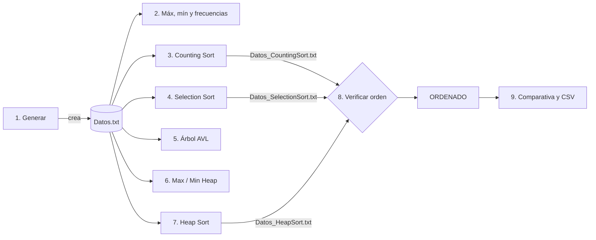

<div align="center">


# ⚙️ Ordenamiento y estructuras avanzadas sobre **100 millones de datos**


</div>

---

## 🎓 Ficha académica

| | |
|---|---|
| 🏛️ **Universidad** | Universidad Nacional de Villa Mercedes (UNViMe), San Luis, Argentina |
| 📘 **Materia** | Análisis y Diseño de Algoritmos |
| 👨‍🏫 **Profesor** | Reinaldo Gómez |
| 👨‍💻 **Alumno** | Jeremías Mendoza |
| 📝 **Trabajo** | Trabajo Práctico N.º 3, *Transformar y Conquistar* · 2026 |

## 📖 Descripción

Programa en **Python** con **menú interactivo** que genera un archivo de **100.000.000 de números aleatorios** (0 a 100.000.000) y lo usa para implementar, medir y comparar:

- 🔢 **Ordenamiento:** Counting Sort, Selection Sort y Heap Sort (con `heapify` iterativo).
- 🌳 **Estructuras:** Árbol **AVL** (con `__slots__` y verificador de invariante) y **Heap Binario** (**Max Heap** y **Min Heap**, implementaciones propias).
- ⏱️ **Tiempos** de cada operación (con `time.perf_counter()`, separando I/O y cómputo), **verificación** automática del orden y **comparativa teórica/empírica** exportable a CSV.

El objetivo es contrastar la **teoría (complejidad asintótica)** con los **tiempos reales** medidos en una PC.

---

## 🧭 Menú y flujo del programa

```text
  1. Generar archivo de datos (100 millones)      7. Ordenar con Heap Sort (y verificar)
  2. Buscar máximo, mínimo y frecuencias          8. Verificar ordenamiento de los archivos
  3. Ordenar con Counting Sort                    9. Comparativa de tiempos y análisis teórico
  4. Ordenar con Selection Sort (100.000 datos)  10. Limpiar consola
  5. Operaciones de Árbol AVL (submenú)          11. Salir
  6. Operaciones de Heap (Max Heap / Min Heap)
```



> 💡 Las opciones **2 a 7** necesitan `Datos.txt`: ejecutá primero la **opción 1**. Tanto la consola (`tp3.py`) como la interfaz gráfica (`ejecutable/tp3_gui.py`) comparten los archivos en la raíz del proyecto.

### ✅ Consignas cubiertas

| a | b, c | d | e | f | g | h | i | j | k | l |
|:---:|:---:|:---:|:---:|:---:|:---:|:---:|:---:|:---:|:---:|:---:|
| Op. 1 | Op. 2 | Op. 3 | Op. 4 | Op. 8 | Op. 1–9 | Código | Op. 5 | Op. 6 (Max/Min) | Op. 7 | Op. 9 + Informe |

---

## 🚀 Cómo ejecutarlo

El proyecto usa **únicamente la biblioteca estándar de Python 3.x** (sin dependencias externas) e incluye versión de consola, versión gráfica (`tkinter`) y pruebas unitarias (`unittest`).

```bash
git clone https://github.com/jeremendoza01/tp3.git
cd tp3

# Opción A: Interfaz gráfica (GUI en Tkinter)
python ejecutable/tp3_gui.py

# Opción B: Consola interactiva
python tp3.py

# Pruebas unitarias automatizadas (AVL, Max/Min Heap, ordenamientos y verificación)
python -m unittest discover -s tests -v
```

**💾 Recursos:** ≈ 1 GB de disco para `Datos.txt` (y otro para `Datos_CountingSort.txt`), ≈ 400 MB de RAM para Counting Sort y análisis de frecuencias (gracias a `array('I')`), y ≈ 0,5 GB para Heap/Heap Sort con 10 M de datos.

## 📂 Estructura del repositorio

```text
📦 tp3
 ┣ 📜 tp3.py                                 # Programa principal (consola interactiva)
 ┣ 📁 ejecutable
 ┃  ┗ 🖥️ tp3_gui.py                          # Interfaz gráfica completa (Tkinter)
 ┣ 📁 tests
 ┃  ┗ 🧪 test_tp3.py                         # Pruebas unitarias (unittest)
 ┣ 📁 informe
 ┃  ┗ 📄 Informe-Tp3-Mendoza-Jeremias.pdf    # Informe técnico y capturas
 ┗ 📘 README.md
```

> Los `Datos*.txt` pesan cerca de 1 GB: agregalos a `.gitignore`.

---

## 📊 Resultados medidos

💻 AMD Ryzen 5 5600GT (3,60 GHz) · 🧠 16 GB RAM · 🪟 Windows 64 bits · 🐍 CPython

| Prueba | n | Tiempo | Complejidad |
|---|---:|---:|:---:|
| 🎲 Generación de `Datos.txt` | 100 M | ≈ 36 s | O(n) |
| 🔎 Máx, mín y frecuencias | 100 M | ≈ 65 a 68 s | O(n) |
| 🟢 **Counting Sort** | 100 M | ≈ 70 s | O(n + k) |
| 🔴 **Selection Sort** | 100 mil | ≈ 150 s (proyección a 100 M: **≈ 5 años**) | O(n²) |
| 🔵 **Heap Sort** | 10 M | ≈ 58 a 70 s (proyección a 100 M: ≈ 11 a 13 min) | O(n log n) |

| Operación | 🌳 AVL (1 M) | ⛰️ Max Heap (10 M) |
|---|---|---|
| Construcción | ≈ 9 a 10 s · altura 24 | ≈ 8 s · altura 23 |
| Inserción | decenas de µs · O(log n) | pocos µs · O(1) promedio |
| Búsqueda | decenas de µs · **O(log n)** | ≈ 0,43 s · **O(n)** |
| Eliminación | decenas de µs (cualquier valor) | decenas de µs (solo el máximo) |

> 📌 Los tiempos varían ≈ 1 a 6 % entre corridas. El análisis completo (Poisson, extrapolaciones, memoria) está en el **[informe en PDF](informe/Informe-Tp3-Mendoza-Jeremias.pdf)**.

| Algoritmo | Espacio auxiliar | In-place | Estable |
|---|:---:|:---:|:---:|
| Counting Sort | O(k) ≈ 400 MB (`array('I')`) | ❌ | ✅ |
| Selection Sort | O(1) | ✅ | ❌ |
| Heap Sort | O(1) (`heapify` iterativo) | ✅ | ❌ |

---

## 🏁 Conclusiones

| Situación | Mejor opción |
|---|---|
| 100 M de enteros con rango acotado | 🟢 **Counting Sort**: lineal, a cambio de memoria |
| Ordenar en general con poca memoria | 🔵 **Heap Sort**: O(n log n) garantizado e in-place |
| Selection Sort con grandes volúmenes | 🔴 **Inviable** (O(n²)) |
| Búsqueda frecuente y aleatoria | 🌳 **AVL**: entre ≈ 1.900 y 19.000 veces más rápido que el heap |
| Cola de prioridad | ⛰️ **Heap**: máximo inmediato y menor memoria |

> No hay un único ganador: la elección depende del recurso crítico (tiempo, memoria o tipo de operación). Los resultados coinciden con la teoría.

**⚠️ Limitaciones:** pocas corridas en una sola PC con Windows; Python es interpretado (importan las proporciones, no los segundos absolutos). Tanto **Max Heap** como **Min Heap** se encuentran implementados en el código.

---

<div align="center">

**👨‍💻 Jeremías Mendoza**
Estudiante de Ingeniería en Sistemas · UNViMe
📘 *Análisis y Diseño de Algoritmos* · 👨‍🏫 Prof. **Reinaldo Gómez** · 📅 2026


</div>
