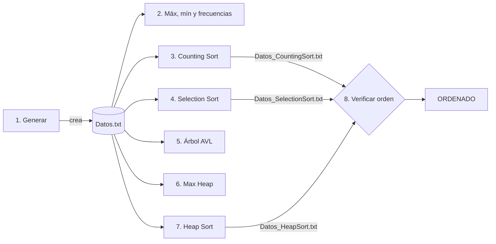

<div align="center">


# ⚙️ Algoritmos de ordenamiento y estructuras avanzadas sobre **100 millones de datos**


</div>

---

## 🎓 Ficha académica

| | |
|---|---|
| 🏛️ **Universidad** | Universidad Nacional de Villa Mercedes (UNViMe), San Luis, Argentina |
| 📘 **Materia** | Análisis y Diseño de Algoritmos |
| 👨‍🏫 **Profesor** | Reinaldo Gómez |
| 👨‍💻 **Alumno** | Jeremías Mendoza |
| 📝 **Trabajo** | Trabajo Práctico N.º 3, *Transformar y Conquistar* |
| 📅 **Año** | 2026 |

---

## 📖 Descripción

Programa en **Python** con **menú interactivo** que genera un archivo de **100.000.000 de números aleatorios** (rango de 0 a 100.000.000) y lo usa para implementar, medir y comparar:

- 🔢 **Algoritmos de ordenamiento:** Counting Sort, Selection Sort y Heap Sort.
- 🌳 **Estructuras de datos:** Árbol **AVL** y **Max Heap** (implementaciones propias, sin librerías de estructuras).
- ⏱️ **Mediciones de tiempo** de cada operación y verificación del orden de los archivos generados.

El objetivo es **contrastar la teoría (complejidad asintótica) con los tiempos reales** medidos en una PC y concluir qué algoritmo y qué estructura conviene según el recurso crítico (tiempo, memoria o tipo de operación).

---

## 📑 Contenido

- [Tecnologías](#-tecnologías-y-herramientas)
- [Conceptos aplicados](#-conceptos-aplicados)
- [Consignas cubiertas](#-consignas-cubiertas)
- [Menú del programa](#-menú-del-programa)
- [Cómo ejecutarlo](#-cómo-ejecutarlo)
- [Arquitectura del programa](#-arquitectura-del-programa)
- [Estructura del repositorio](#-estructura-del-repositorio)
- [Resultados](#-resultados-medidos)
- [Complejidad](#-complejidad-algorítmica)
- [Decisiones de diseño](#-decisiones-de-diseño)
- [Conclusiones](#-conclusiones)
- [Preguntas frecuentes](#-preguntas-frecuentes)
- [Autor](#-autor)

---

## 🧰 Tecnologías y herramientas

<div align="center">


</div>

| | Tecnología | Uso en el proyecto |
|:---:|---|---|
|  | **Python 3** | Lenguaje de todo el programa; solo usa la biblioteca estándar (`random`, `time`, `os`, `collections`, `sys`, `math`) |
|  | **Windows x64** | Sistema donde se midieron los tiempos y se generó el ejecutable `tp3.exe` |
|  | **PowerShell / CMD** | Consola para ejecutar el programa y ver el menú |
|  | **VS Code** | Entorno de desarrollo |
|  | **Git** | Control de versiones |
|  | **GitHub** | Repositorio y distribución del ejecutable (Releases) |
|  | **Markdown** | Documentación (este README) |

---

## 🧩 Conceptos aplicados

El trabajo se enmarca en la técnica **Transformar y Conquistar**: resolver un problema cambiando su representación o simplificando la instancia antes de atacarlo.

| Concepto | Dónde aparece |
|---|---|
| 🌳 **Cambio de representación: árboles de búsqueda balanceados** | Árbol AVL: mantiene los datos ordenados y garantiza altura O(log n) mediante rotaciones |
| ⛰️ **Cambio de representación: montículo (heap)** | Max Heap como cola de prioridad y base de Heap Sort |
| 🔁 **Transformación de instancia** | Heap Sort: el arreglo se transforma en un heap y luego se extrae el máximo repetidamente |
| ⚖️ **Compromiso espacio-tiempo** | Counting Sort: gasta memoria (arreglo de conteo) para ordenar en tiempo lineal |
| 🐢 **Fuerza bruta (referencia de comparación)** | Selection Sort: O(n²), sirve como línea base |
| 🎲 **Distribución de Poisson** | Validación estadística del generador: frecuencias esperadas con λ = 1 |

---

## ✅ Consignas cubiertas

| Consigna | Descripción | Opción del menú | Estado |
|:---:|---|:---:|:---:|
| **a** | Generación de `Datos.txt` (100 M de números) | 1 | ✅ |
| **b** | Búsqueda del máximo y mínimo | 2 | ✅ |
| **c** | Análisis de frecuencia (top 10) | 2 | ✅ |
| **d** | Ordenamiento con Counting Sort | 3 | ✅ |
| **e** | Ordenamiento con Selection Sort | 4 | ✅ |
| **f** | Verificación del ordenamiento | 8 | ✅ |
| **g** | Medición de tiempos | 1 a 7 | ✅ |
| **h** | Documentación en el código | todo el código | ✅ |
| **i** | Árbol AVL (inserción, búsqueda, eliminación, altura, nodos, InOrden) | 5 | ✅ |
| **j** | Heap binario (inserción, búsqueda, extracción del máximo) | 6 | ✅ |
| **k** | Heap Sort (`Datos_HeapSort.txt`) | 7 | ✅ |
| **l** | Comparación de estructuras y algoritmos | Informe | ✅ |

---

## 🧭 Menú del programa

```text
============================================================
 1. Generar archivo de datos (100 millones completos)
 2. Buscar Máximo, Mínimo y Frecuencias
 3. Ordenar con Counting Sort (100 millones completos - O(n+k))
 4. Ordenar con Selection Sort (muestra de 100.000 datos - O(n^2))
 5. Operaciones de Árbol AVL
 6. Operaciones de Max Heap
 7. Ordenar con Heap Sort
 8. Verificar ordenamiento de todos los archivos generados
 9. Limpiar consola
10. Salir
============================================================
```



> 💡 Las opciones **2 a 7** necesitan que `Datos.txt` exista: ejecutá primero la **opción 1**.

---

## 🚀 Cómo ejecutarlo

### Opción A: ejecutable (Windows 64 bits, sin instalar Python)

1. Descargá `tp3.exe` desde la sección **Releases** (o desde la carpeta `ejecutable/`).
2. Hacé doble clic, o abrilo desde una consola (`cmd` o PowerShell) para que la ventana no se cierre al terminar.
3. El programa crea los archivos de datos **en la misma carpeta** donde se ejecuta.

> ⚠️ Al ser un ejecutable sin firma digital, Windows SmartScreen o el antivirus pueden mostrar una advertencia. El código fuente completo está en este repositorio (`tp3.py`).

### Opción B: desde el código fuente (cualquier sistema)

```bash
# 1. Clonar el repositorio
git clone https://github.com/<tu-usuario>/<nombre-del-repo>.git
cd <nombre-del-repo>

# 2. Ejecutar (solo usa la biblioteca estándar de Python 3)
python tp3.py
```

### 💾 Recursos necesarios

| Recurso | Requerimiento aproximado |
|---|---|
| Disco | ≈ 1 GB para `Datos.txt` y ≈ 1 GB más para `Datos_CountingSort.txt` |
| RAM, opción 3 (Counting Sort) | ≈ 1 GB libre |
| RAM, opciones 6 y 7 con 10 M de datos | ≈ 0,5 GB libre |
| Tiempo total aproximado | varios minutos (ver tabla de resultados) |

---

## 🏗️ Arquitectura del programa

| Componente | Tipo | Responsabilidad |
|---|---|---|
| `NodoAVL` | Clase | Nodo con valor, altura y punteros izquierdo y derecho |
| `ArbolAVL` | Clase | Inserción, búsqueda, eliminación, rotaciones, rebalanceo, recorrido InOrden y conteo de nodos |
| `MaxHeap` | Clase | Heap binario en arreglo: inserción, extracción del máximo, `heapify_down` y búsqueda lineal |
| `generar_archivo_datos()` | Función | Genera `Datos.txt` en bloques de 1.000.000 de números |
| `buscar_max_min_y_frecuencia()` | Función | Un solo recorrido: máximo, mínimo y top 10 con `Counter` |
| `ordenar_counting_sort()` | Función | Ordenamiento por conteo con salida en archivo |
| `ordenar_selection_sort(limite)` | Función | Ordenamiento por selección sobre una muestra |
| `operar_arbol_avl(limite)` | Función | Construye el AVL y ofrece insertar, buscar y eliminar con tiempos |
| `operar_heap(limite)` | Función | Construye el Max Heap y ofrece insertar, buscar y extraer el máximo con tiempos |
| `ordenar_heap_sort(limite)` | Función | Heap Sort in-place con construcción bottom-up |
| `verificar_orden(archivo)` | Función | Recorre el archivo comprobando `a[i] ≤ a[i+1]` |
| `mostrar_menu()` | Función | Bucle principal del menú interactivo |

### 📄 Archivos que genera el programa

| Archivo | Lo crea la opción | Contenido | Tamaño aprox. |
|---|:---:|---|---|
| `Datos.txt` | 1 | 100.000.000 de enteros aleatorios (0 a 100.000.000), uno por línea | ≈ 1 GB |
| `Datos_CountingSort.txt` | 3 | Los 100 M de datos ordenados ascendentemente | ≈ 1 GB |
| `Datos_SelectionSort.txt` | 4 | La muestra de 100.000 datos ordenada | ≈ 1 MB |
| `Datos_HeapSort.txt` | 7 | La muestra elegida (por defecto 10 M) ordenada | ≈ 90 a 100 MB |

---

## 📂 Estructura del repositorio

```text
📦 tp3-analisis-y-diseno-de-algoritmos
 ┣ 📜 tp3.py                  # Código fuente (menú, algoritmos y estructuras)
 ┣ 📁 ejecutable
 ┃ ┗ ⚙️ tp3.exe               # Ejecutable para Windows x64
 ┣ 📁 informe
 ┃ ┗ 📄 Informe-Tp3-Mendoza-Jeremias.pdf
 ┗ 📘 README.md
```

> Los archivos `Datos*.txt` pesan cerca de 1 GB: **no se suben al repositorio** (agregalos a `.gitignore`).

---

## 📊 Resultados medidos

**Equipo de pruebas:** 💻 AMD Ryzen 5 5600GT (3,60 GHz) · 🧠 16 GB RAM (15,4 GB utilizables) · 🪟 Windows 64 bits · 🐍 Python (CPython)

### Ordenamiento

| Algoritmo | n probado | Tiempo medido | Tiempo por elemento | Proyección a 100 M |
|---|---:|---:|---:|---|
| 🟢 **Counting Sort** | 100.000.000 | ≈ 70 s | ≈ 0,7 µs | ≈ 70 s (medido) |
| 🔴 **Selection Sort** | 100.000 | ≈ 150 s | ≈ 1,5 ms | ≈ **5 años** |
| 🔵 **Heap Sort** | 10.000.000 | ≈ 58 a 70 s | ≈ 6 a 7 µs | ≈ 11 a 13 min (estimación) |

### Archivo de datos

| Operación | n | Tiempo |
|---|---:|---:|
| 🎲 Generación de `Datos.txt` | 100.000.000 | ≈ 36 s |
| 🔎 Máximo, mínimo y frecuencias (un solo recorrido) | 100.000.000 | ≈ 65 a 68 s |
| ✔️ Verificación de `Datos_CountingSort.txt` | 100.000.000 | ≈ 18 s |

### Estructuras de datos

| Operación | 🌳 Árbol AVL (n = 1 M) | ⛰️ Max Heap (n = 10 M) |
|---|---|---|
| Construcción | ≈ 9 a 10 s (altura 24) | ≈ 8 s (altura 23) |
| Inserción | decenas de µs | unos pocos µs |
| Búsqueda | decenas de µs (**O(log n)**) | ≈ 0,43 a 0,44 s (**O(n)**) |
| Eliminación | decenas de µs (cualquier valor) | decenas de µs (solo el máximo) |

> 📌 Los tiempos varían entre corridas (≈ 1 a 6 %). Las operaciones individuales, del orden de microsegundos, deben leerse como órdenes de magnitud. El detalle, las extrapolaciones y el análisis estadístico están en el **[informe en PDF](informe/Informe-Tp3-Mendoza-Jeremias.pdf)**.

<details>
<summary><b>🎲 Validación estadística de los datos (Poisson)</b></summary>

Con 10⁸ valores uniformes sobre ≈ 10⁸ posibilidades, la cantidad de apariciones de cada valor sigue una distribución de Poisson de media λ = 1. Se esperan ≈ 1 valor con 11 o más apariciones y ≈ 10 valores con exactamente 10, por lo que un máximo de 10 u 11 repeticiones es el comportamiento esperado de un generador sin sesgos.

</details>

---

## 📐 Complejidad algorítmica

| Algoritmo | Mejor caso | Peor caso | Espacio auxiliar | In-place | Estable |
|---|:---:|:---:|:---:|:---:|:---:|
| **Counting Sort** | O(n + k) | O(n + k) | O(k) | ❌ | ✅ |
| **Selection Sort** | O(n²) | O(n²) | O(1) | ✅ | ❌ |
| **Heap Sort** | O(n log n) | O(n log n) | O(1) | ✅ | ❌ |

| Operación | 🌳 AVL | ⛰️ Heap |
|---|:---:|:---:|
| Inserción | O(log n) | O(log n) peor caso, O(1) promedio |
| Búsqueda | O(log n) | O(n) |
| Eliminación | O(log n), cualquier valor | O(log n), solo la raíz |

---

## 🧠 Decisiones de diseño

- 📥 **Streaming:** los archivos se leen línea a línea; los 100 M de datos nunca se cargan completos en memoria, salvo en las muestras de estructuras.
- 🔗 **Opciones 2 y 3 combinadas:** máximo, mínimo y frecuencias se resuelven en **una sola pasada** con un `Counter` (tabla hash).
- 🎯 **Counting Sort** con arreglo de k + 1 = 100.000.001 posiciones (≈ 800 MB en CPython); la memoria depende de k, no de n.
- 📉 **Muestras justificadas:** Selection Sort (100 mil) por su costo cuadrático, AVL (1 M) por el consumo de memoria de los nodos, Heap y Heap Sort (hasta 10 M).
- ⚖️ **AVL con duplicados:** el rebalanceo se decide con el factor de balance del hijo (no comparando valores), lo que mantiene el invariante AVL incluso con valores repetidos.
- ⛰️ **Heap Sort in-place:** construcción *bottom-up* (O(n)) y n − 1 extracciones; el `heapify` recursivo tiene profundidad ≤ log₂ n.
- 🛠️ **Implementaciones propias** del AVL y del heap, sin librerías de estructuras de datos.

---

## 🏁 Conclusiones

| Situación | Mejor opción | Motivo |
|---|---|---|
| 100 M de enteros con rango acotado | 🟢 **Counting Sort** | Costo lineal, a cambio de ≈ 800 MB de memoria |
| Ordenar en general, con poca memoria | 🔵 **Heap Sort** | O(n log n) garantizado, in-place, sin depender del rango |
| Ordenar grandes volúmenes con Selection Sort | 🔴 **Inviable** | O(n²): ≈ 5 años proyectados para 100 M |
| Búsqueda frecuente y aleatoria | 🌳 **Árbol AVL** | Búsqueda en microsegundos; entre ≈ 1.900 y 19.000 veces más rápida que el heap |
| Cola de prioridad | ⛰️ **Heap** | Máximo inmediato, inserción barata, menor memoria |

> No existe un único ganador: la elección depende del recurso crítico (tiempo, memoria o tipo de operación). Los resultados medidos coinciden con las predicciones teóricas.

---

## ⚠️ Limitaciones

- Una o pocas corridas por medición, en una sola PC con Windows.
- Python es interpretado: los tiempos absolutos son mayores que en C; lo relevante son las proporciones y el crecimiento asintótico.
- Se implementó el **Max Heap**; el Min Heap es simétrico (invirtiendo las comparaciones).

---

## ❓ Preguntas frecuentes

<details>
<summary><b>¿Por qué Selection Sort usa solo 100.000 datos?</b></summary>

Porque es O(n²). Con 100.000 elementos tarda ≈ 2,5 minutos; con los 100 millones de la consigna tardaría ≈ 5 años. La muestra reducida está justificada y documentada en el informe.

</details>

<details>
<summary><b>¿Por qué el AVL y el Heap no usan los 100 millones?</b></summary>

Cada nodo del AVL es un objeto con punteros y ocupa varias veces más memoria que una celda del heap. Con 100 M de nodos se superaría la RAM disponible; por eso se usan 1 M (AVL) y 10 M (Heap).

</details>

<details>
<summary><b>¿Por qué Windows o el antivirus advierten sobre el .exe?</b></summary>

El ejecutable no está firmado digitalmente. Es normal en programas de estudiantes. Si no querés ejecutarlo, podés correr `python tp3.py` con el mismo resultado.

</details>

<details>
<summary><b>¿Por qué los tiempos cambian entre corridas?</b></summary>

Dependen del estado de la PC (procesos en segundo plano, disco, caché). Las variaciones observadas fueron de ≈ 1 a 6 %; lo importante son las proporciones entre algoritmos y su crecimiento asintótico.

</details>

<details>
<summary><b>¿Se puede cambiar el rango o la cantidad de datos?</b></summary>

Sí, editando las constantes `CANTIDAD_NUMEROS` (n) y `RANGO_MAX` (k) al inicio de `tp3.py`. La cantidad debe ser múltiplo de 1.000.000 porque el archivo se escribe en bloques de ese tamaño. Counting Sort necesita un arreglo de k + 1 posiciones, y el archivo crece ≈ 10 bytes por número.

</details>

---

## 👨‍💻 Autor

<div align="center">

**Jeremías Mendoza**
Estudiante de Ingeniería en Sistemas · Universidad Nacional de Villa Mercedes (UNViMe)

📘 *Análisis y Diseño de Algoritmos* · 👨‍🏫 Prof. **Reinaldo Gómez** · 📅 2026


</div>
