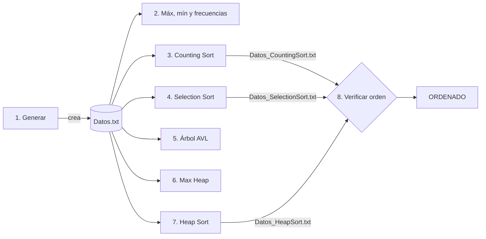

<div align="center">


# ⚙️ Ordenamiento y estructuras avanzadas sobre **100 millones de datos**


</div>

---

## 🎓 Ficha académica

| | |
|---|---|
| 🏛️ **Universidad** | Universidad Nacional de Villa Mercedes (UNViMe), San Luis, Argentina |
| 📘 **Materia** | Análisis y Diseño de Algoritmos |
| 👨‍🏫 **Profesor** | Reinaldo Gómez |
| 👨‍💻 **Alumno** | Jeremías Mendoza |
| 📝 **Trabajo** | Trabajo Práctico N.º 3, *Transformar y Conquistar* · 2026 |

## 📖 Descripción

Programa en **Python** con **menú interactivo** que genera un archivo de **100.000.000 de números aleatorios** (0 a 100.000.000) y lo usa para implementar, medir y comparar:

- 🔢 **Ordenamiento:** Counting Sort, Selection Sort y Heap Sort.
- 🌳 **Estructuras:** Árbol **AVL** y **Max Heap** (implementaciones propias).
- ⏱️ **Tiempos** de cada operación y **verificación** del orden de los archivos generados.

El objetivo es contrastar la **teoría (complejidad asintótica)** con los **tiempos reales** medidos en una PC.

---

## 🧭 Menú y flujo del programa

```text
 1. Generar archivo de datos (100 millones)      6. Operaciones de Max Heap
 2. Buscar máximo, mínimo y frecuencias          7. Ordenar con Heap Sort
 3. Ordenar con Counting Sort                    8. Verificar ordenamiento de los archivos
 4. Ordenar con Selection Sort (100.000 datos)   9. Limpiar consola
 5. Operaciones de Árbol AVL                    10. Salir
```



> 💡 Las opciones **2 a 7** necesitan `Datos.txt`: ejecutá primero la **opción 1**.

### ✅ Consignas cubiertas

| a | b, c | d | e | f | g | h | i | j | k | l |
|:---:|:---:|:---:|:---:|:---:|:---:|:---:|:---:|:---:|:---:|:---:|
| Op. 1 | Op. 2 | Op. 3 | Op. 4 | Op. 8 | Op. 1 a 7 | Código | Op. 5 | Op. 6 | Op. 7 | Informe |

---

## 🚀 Cómo ejecutarlo

**Para iniciar el programa con su interfaz gráfica, solo necesitás tener **Python 3.x** instalado. El script utiliza únicamente la biblioteca estándar, por lo que no requiere instalaciones adicionales (sin dependencias externas).**
1. Cloná el repositorio en tu PC:
   ```bash
   git clone [https://github.com/jeremendoza01/tp3.git](https://github.com/jeremendoza01/tp3.git)

**Ejecutá el archivo principal:**
```bash
   python tp3_gui.py
```
**Opción B: código fuente (solo biblioteca estándar)**

```bash
   git clone https://github.com/jeremendoza01/tp3.git
   cd tp3
   python tp3.py
```

**💾 Recursos:** ≈ 1 GB de disco para `Datos.txt` (y otro para `Datos_CountingSort.txt`), ≈ 1 GB de RAM para Counting Sort y ≈ 0,5 GB para Heap/Heap Sort con 10 M de datos.

## 📂 Estructura del repositorio

```text
📦 tp3-analisis-y-diseno-de-algoritmos
 ┣ 📜 tp3.py                       # Código fuente
 ┣ 📁 ejecutable  ┗ ⚙️ tp3_gui.py     # Python
 ┣ 📁 informe     ┗ 📄 Informe-Tp3-Mendoza-Jeremias.pdf
 ┗ 📘 README.md
```

> Los `Datos*.txt` pesan cerca de 1 GB: agregalos a `.gitignore`.

---

## 📊 Resultados medidos

💻 AMD Ryzen 5 5600GT (3,60 GHz) · 🧠 16 GB RAM · 🪟 Windows 64 bits · 🐍 CPython

| Prueba | n | Tiempo | Complejidad |
|---|---:|---:|:---:|
| 🎲 Generación de `Datos.txt` | 100 M | ≈ 36 s | O(n) |
| 🔎 Máx, mín y frecuencias | 100 M | ≈ 65 a 68 s | O(n) |
| 🟢 **Counting Sort** | 100 M | ≈ 70 s | O(n + k) |
| 🔴 **Selection Sort** | 100 mil | ≈ 150 s (proyección a 100 M: **≈ 5 años**) | O(n²) |
| 🔵 **Heap Sort** | 10 M | ≈ 58 a 70 s (proyección a 100 M: ≈ 11 a 13 min) | O(n log n) |

| Operación | 🌳 AVL (1 M) | ⛰️ Max Heap (10 M) |
|---|---|---|
| Construcción | ≈ 9 a 10 s · altura 24 | ≈ 8 s · altura 23 |
| Inserción | decenas de µs · O(log n) | pocos µs · O(1) promedio |
| Búsqueda | decenas de µs · **O(log n)** | ≈ 0,43 s · **O(n)** |
| Eliminación | decenas de µs (cualquier valor) | decenas de µs (solo el máximo) |

> 📌 Los tiempos varían ≈ 1 a 6 % entre corridas. El análisis completo (Poisson, extrapolaciones, memoria) está en el **[informe en PDF](informe/Informe-Tp3-Mendoza-Jeremias.pdf)**.

| Algoritmo | Espacio auxiliar | In-place | Estable |
|---|:---:|:---:|:---:|
| Counting Sort | O(k) ≈ 800 MB | ❌ | ✅ |
| Selection Sort | O(1) | ✅ | ❌ |
| Heap Sort | O(1) | ✅ | ❌ |

---

## 🏁 Conclusiones

| Situación | Mejor opción |
|---|---|
| 100 M de enteros con rango acotado | 🟢 **Counting Sort**: lineal, a cambio de memoria |
| Ordenar en general con poca memoria | 🔵 **Heap Sort**: O(n log n) garantizado e in-place |
| Selection Sort con grandes volúmenes | 🔴 **Inviable** (O(n²)) |
| Búsqueda frecuente y aleatoria | 🌳 **AVL**: entre ≈ 1.900 y 19.000 veces más rápido que el heap |
| Cola de prioridad | ⛰️ **Heap**: máximo inmediato y menor memoria |

> No hay un único ganador: la elección depende del recurso crítico (tiempo, memoria o tipo de operación). Los resultados coinciden con la teoría.

**⚠️ Limitaciones:** pocas corridas en una sola PC con Windows; Python es interpretado (importan las proporciones, no los segundos absolutos); se implementó Max Heap (el Min Heap es simétrico).

---

<div align="center">

**👨‍💻 Jeremías Mendoza**
Estudiante de Ingeniería en Sistemas · UNViMe
📘 *Análisis y Diseño de Algoritmos* · 👨‍🏫 Prof. **Reinaldo Gómez** · 📅 2026


</div>
